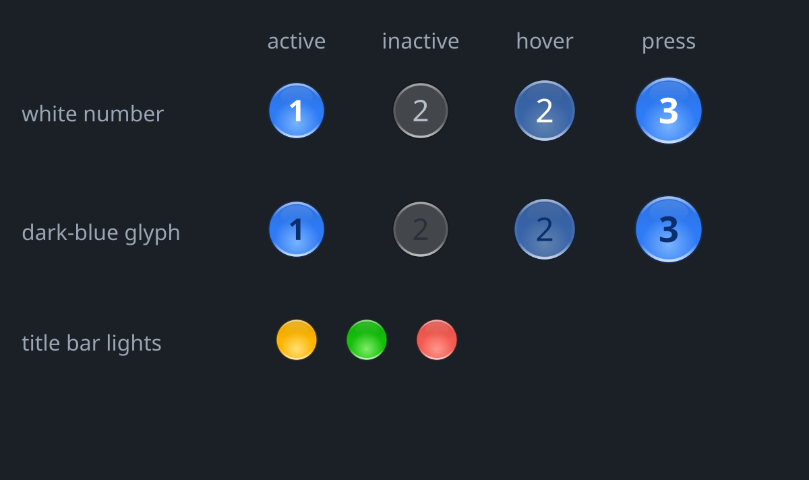

# Aero and Mac looks

Two KDE Global Themes for this ShojiWM session. You pick them in System
Settings > Colors & Themes > Global Theme, like any other theme.

| | ShojiWM Mac | ShojiWM Aero |
| --- | --- | --- |
| Panel | your panel, Plasma theme `default` | dark smoky glass (Seven-Black), blurred by ShojiWM |
| Start button | Kickoff | SevenStart menu with a glowing glass orb that sticks out above the panel |
| Title bars | macOS style glass traffic lights | dark Aero glass bar with the same traffic lights |
| Popups, menus | Breeze Dark | dark Aero colours (`ShojiWMAeroDark`), dark start menu |
| Workspace numbers | plain circles | blue glass lights, like the traffic lights |

Both looks also get:

- **Trash toggle** (`plasmoids/org.shojiwm.trashtoggle`): click the trash on
  the panel to open it, click again to minimize it, again to bring it back.
  KDE's own trash widget opens a new window every time.
- **No taskbar hover previews.** They stream a live picture of the window and
  could stay stuck on screen under ShojiWM.



## What you need

- This config, from the
  [dcrey7/ShojiWM `kde-plasma-session`](https://github.com/dcrey7/ShojiWM/tree/kde-plasma-session)
  branch at commit `90bb9be` or later. The Aero title bars, the panel blur and
  the theme switch live in that config (`packages/config`).
- `git`, `python3` (or `uv`), `rsvg-convert` and ImageMagick (`magick`, only
  to redraw the orb).
- AeroThemePlasma, downloaded by a script (see below).

## Build

Run these from the `plasma-themes/` folder. None of them need root.

```sh
# 1. Download AeroThemePlasma (pinned commit, branch Plasma/6.7).
sh bin/fetch-aerothemeplasma.sh

# 2. The Aero Plasma theme (ShojiWM-Aero), the dark colours and the dark menu.
python3 bin/make-aero-plasma-theme.py
python3 bin/make-aero-colors.py
python3 bin/patch-sevenstart.py

# 3. The trash toggle and the workspace lights.
mkdir -p ~/.local/share/plasma/plasmoids
cp -r plasmoids/org.shojiwm.trashtoggle ~/.local/share/plasma/plasmoids/
python3 bin/patch-workspace-indicator.py

# 4. The two Global Themes. Do this while your panel looks the way you like:
#    both looks rebuild your panel and desktop widgets from it.
SHOJI_START_ICON=start-here-kde python3 bin/make-global-themes.py

# 5. Optional: the red glass close light in your user icon theme (it shows on
#    notifications and in KDE apps). Pass the name of a theme that lives in
#    ~/.local/share/icons.
python3 bin/close_button.py my-icon-theme
```

`patch-workspace-indicator.py` patches the `cachyos.workspace-indicator`
widget that CachyOS installs. Skip it if you use KDE's Pager instead.

## Switch

- **System Settings:** Colors & Themes > Global Theme > "ShojiWM Aero" or
  "ShojiWM Mac" > Apply. Tick "Desktop and window layout" to swap the start
  button and panel too.
- **Terminal:** `bin/shoji-theme aero`, `bin/shoji-theme mac` or
  `bin/shoji-theme status`.

The title bars follow the theme you pick by themselves (the config watches
`LookAndFeelPackage` in `~/.config/kdeglobals`).

System Settings only works fully when the session puts
`~/.config/kdedefaults` on `XDG_CONFIG_DIRS`. KDE's own session does that; the
ShojiWM config from the fork branch does it too.

## The start orb

`assets/start-orb/make_orb.py` draws the orb as SVG (rest, hover, pressed)
and stacks the three into `start-orb-sheet.png`, which SevenStart uses as its
button. Edit `ICON_DOTS` in that file to put your own icon in the middle.

For the orb to stick out above the panel, SevenStart needs a replacement
`StartOrb.qml` that draws it in its own layer-shell window. That file is a
rewrite of SevenStart's own and so falls under AGPL-3.0; this repo does not
ship it. Without it the orb stays inside the panel. To use it, put the file
next to `bin/patch-sevenstart.py` and run that script again.

## Remove

```sh
rm -r ~/.local/share/plasma/look-and-feel/org.shojiwm.aero.desktop \
      ~/.local/share/plasma/look-and-feel/org.shojiwm.mac.desktop \
      ~/.local/share/plasma/desktoptheme/ShojiWM-Aero \
      ~/.local/share/plasma/plasmoids/io.gitgud.wackyideas.SevenStart \
      ~/.local/share/plasma/plasmoids/org.shojiwm.trashtoggle \
      ~/.local/share/color-schemes/ShojiWMAeroDark.colors
```

The original workspace indicator is kept in
`~/.local/state/shojiwm-themes/backups/workspace-indicator-original/`. Then
pick another Global Theme and restart plasmashell (`bin/restart-plasmashell.sh`).

## What does not work without KWin

- KWin effects, window decorations, the tab box and KWin scripts from
  AeroThemePlasma.
- The patched libplasma menu frame from AeroThemePlasma (the Seven-Black
  dialog background is used instead).
- Blur behind Qt right-click menus (they are dark and 80% opaque instead).

## Credits and licences

- This folder is part of shojiwm-kde-config, GPL-3.0-or-later.
- [AeroThemePlasma](https://github.com/aeroshell-desktop/aerothemeplasma)
  (AGPL-3.0) by the AeroShell project gives the Seven-Black Plasma theme and
  the SevenStart menu. The scripts download it and patch copies on your
  machine; none of its files are in this repo.
- `cachyos.workspace-indicator` is CachyOS's widget; the script patches your
  installed copy.
